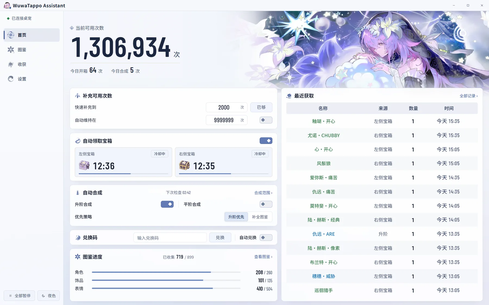
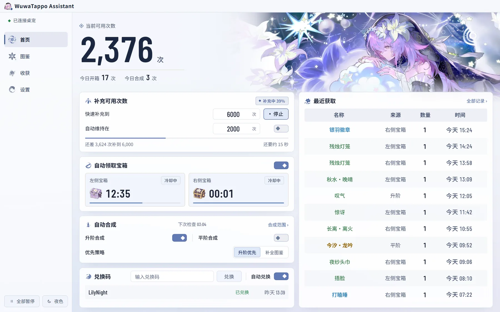
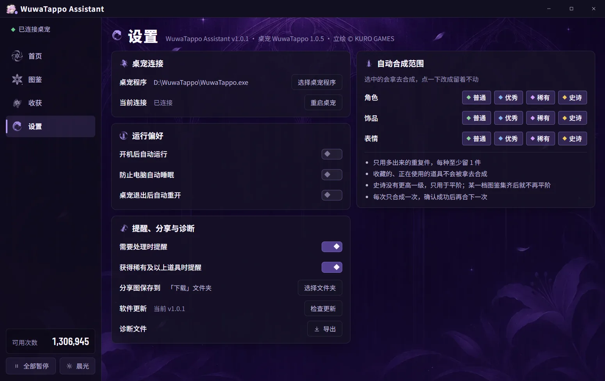

# WuwaTappo Assistant

**《鸣潮》官方桌宠 WuwaTappo 的 Windows 后台小助手。打开它，桌宠就交给它照看：自动补次数、自动领宝箱、自动合成重复道具、自动兑换兑换码，还能看图鉴进度和开箱统计、一键生成分享图。**

界面以《鸣潮》角色莉莉为主题，有「晨光」「夜色」两套样子。免费、不用安装，解压就能用。

[**⬇ 下载最新版**](../../releases/latest) · [兑换码清单](redeem-codes.json) · [问题反馈](../../issues)

首页（晨光）。本页截图都是示例数据，不是真实账号。

---

## 它能帮你做什么

| 平时的麻烦 | 交给助手 |
|---|---|
| 宝箱冷却好了没人点，白白浪费时间 | 冷却一到、次数够 1000，**自动领取**，并核对领到了什么 |
| 次数不够开箱 | 低于你设的数就**自动补回来**，或一键补到某个数 |
| 重复道具堆着，一个个合成太麻烦 | **自动升阶 / 平阶**，只用多出来的，收藏的和正在用的不动 |
| 官方发了兑换码，不知道或者忘了兑 | **自动兑换**：官方新码通常几小时内自动兑掉，不用手动输入 |
| 不知道自己集了多少、运气怎么样 | 图鉴进度、开箱统计、出货和官方概率对比、全部获取记录 |
| 想晒一下 | 一键生成图鉴图、出货图，自动复制，直接粘贴 |

## 下载和安装

1. 先装好并登录 WuwaTappo 桌宠（目前适配桌宠 1.0.5）。
2. 到 [Releases](../../releases/latest) 下载 `WuwaTappo-Assistant-win-x64.zip`，解压到任意位置。
3. 双击 `WuwaTappo Assistant.exe`。不用安装，桌宠没开它会替你打开，十几秒内自己连上。

- 需要 Windows 10 / 11（64 位）和 Microsoft Edge WebView2（Windows 11 自带，Windows 10 一般也已经有）。
- 第一次打开如果看到「Windows 已保护你的电脑」，点「更多信息」→「仍要运行」。这是因为程序没有购买代码签名。
- 以后有新版，在「设置」里点「检查更新」就能看到；换新版直接替换 exe，设置和记录都会保留。

---

## 功能介绍

### 首页：一眼看清，开关一点就行

- **补充可用次数**
  - 「快速补充到」：填个数，点「补充」，补到这个数就停；补的时候能看到进度、还差多少、大约还要多久。
  - 「自动维持在」：打开后，次数低于这个数就自动补回来。平时像人手点一样不紧不慢，快到下一个宝箱时会自动加快，保证宝箱好的时候次数够。
- **自动领取宝箱**：左右两个宝箱各有倒计时；次数不够时宝箱上有「补够」按钮，一点就补到刚好能开。万一领取结果没确认，会先停下等你「核对」，不会重复领。
- **自动合成**：「升阶合成」（10 个换 1 个高一级）和「平阶合成」（5 个换 1 个同级、补没集到的），两种都开时可以选「升阶优先」或「补全图鉴」。
- **兑换码**：输入码点「兑换」；「自动兑换」默认开着（详见下面「兑换码自动兑换」）。
- **最近获取**：刚开到、合到的道具，名字按品质上色，写着来自哪个宝箱或哪种合成。
- 窗口拉到最大，首页还会多出「图鉴进度」：角色、饰品、表情各集了多少。

### 图鉴：集了多少、还差什么、能合几次

- 角色、饰品、表情分开看，每类按 普通 / 优秀 / 稀有 / 史诗 四档统计：集了几件、还差几件、现在材料够升阶或平阶几次。
- 点一档只看这一档；可以搜名称，筛「未拥有」「多余重复」。★ 表示收藏或正在使用，不会被拿去合成。
- **「分享图鉴」**：把这一类已经收集到的道具画成一张图，署上你在桌宠里的昵称和 UID，自动复制到剪贴板，直接粘贴就能发。

### 收获：开箱统计和运气

- 今日、近 7 天、累计开了多少箱，累计合成多少次；近 14 天每天开了几箱。
- **宝箱奖励品质**：每档开出的次数和实际占比，旁边对照官方概率；还会告诉你已经连续多少箱没出稀有、史诗。
- **获取记录**：全部记录可以搜索，按品质、按来源（宝箱 / 升阶 / 平阶）筛选；每条记录都能一键生成一张出货分享图。

### 设置：按你的习惯来

- **运行偏好**：开机后自动运行、挂机时防止电脑睡眠（屏幕照样可以关）、桌宠退出后自动重开（需要以管理员身份运行助手）。
- **自动合成范围**：按「角色 / 饰品 / 表情 × 四档品质」决定哪些可以拿去合成，不想动的点一下留着。
- **提醒和分享**：需要处理时提醒、开出稀有及以上道具时提醒；分享图存到哪个文件夹由你定。

### 两套样子，窗口怎么拉都好看

  
  

- 「晨光」是白蓝色，取自莉莉联邦时期医师装的配色；「夜色」是黑紫色。左下角一键切换。
- 窗口最小 920×600 也能一屏看全所有功能；拉大不是单纯放大，而是多显示内容（横幅和数字一起变大、记录多显示几条、多出图鉴进度）。

---

## 兑换码自动兑换

这是助手最省心的功能，大致是这样运作的：

1. 本仓库里有一份公开的 [兑换码清单](redeem-codes.json)。
2. 一个自动任务**每两小时**去看 TapTap 鸣潮论坛里《鸣潮》官方号的最新帖子，把提到 Wuwa Tappo 的帖子里写着的「兑换码：XXX」收进清单，连同有效期和来源帖子一起记下。只收明确属于桌宠的码；有效期写得看不准的先不收，等人工确认。过期一个月后从清单里拿掉。
3. 你的助手每隔几个小时来看一眼清单，桌宠登录时把**这个账号还没兑过的码**自动兑掉。每个账号分开记，换了号也不会兑错。

所以官方在 TapTap 发码后，通常几小时内大家的助手就自动兑好了，不用更新助手，也不用自己输入。目前清单只从 TapTap 官方帖收录；只在别的地方公布的码，可以在首页手动输入兑换。不想自动兑换的话，在首页把「自动兑换」关掉就行。

## 省心的小细节

- **打开就连上**：连接的十几秒里只显示「正在连接…」，不用点任何东西；要登录时提示「请先在桌宠里登录」，登完自动继续。所有提示都是大白话。
- **关窗不退出**：关掉窗口后在右下角托盘里继续工作，双击托盘图标就回来；右键托盘图标选「退出」才真正退出。
- **不打扰**：只在需要你处理时提醒（断开太久、要登录、领取结果要核对）；全屏玩游戏或看视频时先不弹，退出全屏后再说。
- **能撤销**：「全部暂停」一键停下所有自动任务，提示里有「撤销」；打开合成时也有「关掉」，误点了马上能收回。

## 隐私

- 昵称和 UID 只用来画分享图，不保存、不上传。
- 助手的设置和记录只存在你自己电脑上（`%LOCALAPPDATA%\WuwaHelper`）。助手只会从网上读两样东西：本仓库的兑换码清单，以及「检查更新」时的版本信息。
- 「设置 → 诊断文件 → 导出」生成的文件只有助手自己的设置和运行记录，不含账号信息、兑换记录，也不含你电脑上的文件夹名。

## 常见问题

**需要一直开着桌宠和助手吗？**
需要。助手是在桌宠打开的时候帮你照看；关掉窗口它会在托盘里继续工作。可以在设置里打开「开机后自动运行」。

**会不会把重复道具全合掉？**
不会。只用多出来的，每种至少留 1 件；收藏的、正在使用的不动；还可以在「自动合成范围」里把整类留着不动。

**桌宠更新后助手不能用了怎么办？**
助手会提示「暂时连不上现在的桌宠」，这期间可以先在桌宠里手动操作；助手适配后发新版，「检查更新」就能看到。

**怎么反馈问题？**
到 [Issues](../../issues) 留言，最好附上「设置 → 诊断文件 → 导出」生成的文件。

---

## 说明

本工具由玩家制作，与库洛游戏（KURO GAMES）官方无关。界面里的立绘和游戏素材版权归 KURO GAMES 所有。
