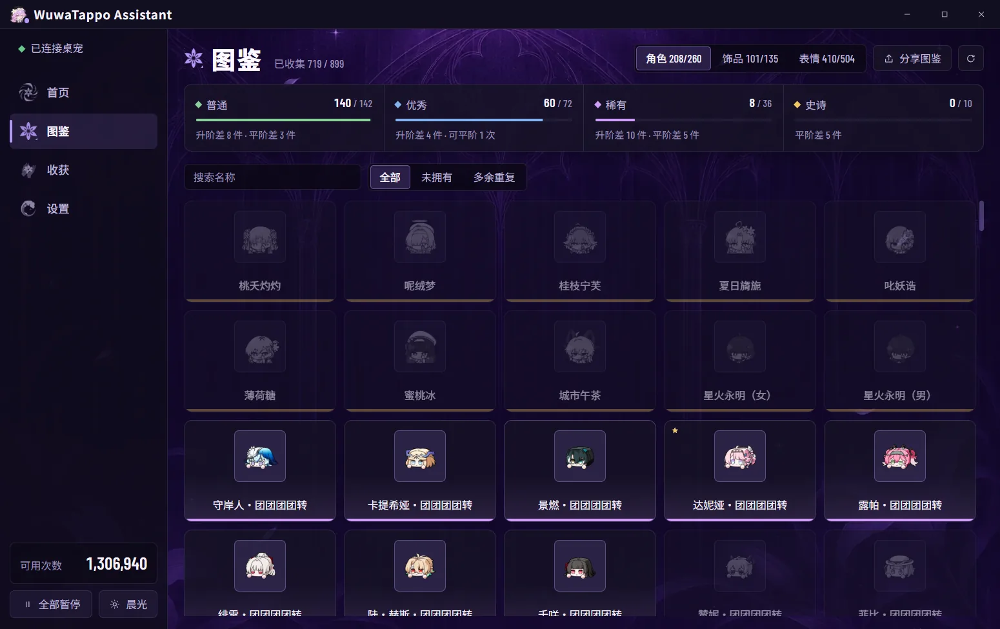
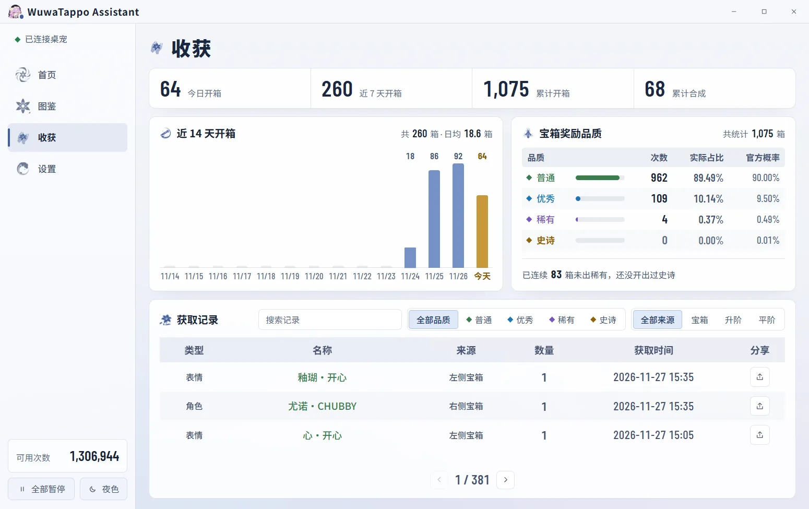
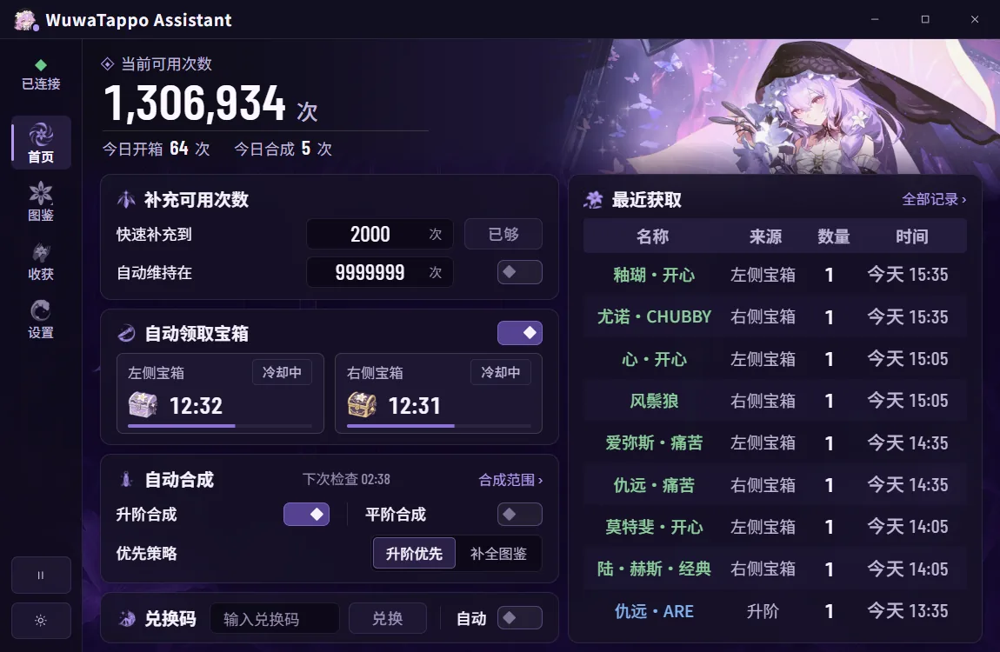

# WuwaTappo Assistant

**把《鸣潮》官方桌宠 WuwaTappo 交给它照看** 
自动补次数 · 自动领宝箱 · 自动合成重复道具 · 自动兑换兑换码 · 看图鉴算概率 · 一键生成分享图

界面以《鸣潮》角色**莉莉**为主题，自带「晨光」「夜色」两套配色。免费、免安装，解压就能用。

[**⬇ 下载最新版**](../../releases/latest) · [查看兑换码清单](redeem-codes.json) · [问题反馈](../../issues)

首页（晨光）—— 大窗口下一次看完可用次数、自动任务、兑换码和图鉴进度

---

## 它能帮你省什么事

平时挂着 WuwaTappo 收集角色、饰品和表情，总免不了惦记着补次数、点宝箱、合重复件、找兑换码。打开助手，这些琐事交给它就行——它只帮你做平时手动点的操作，不改出货概率，让桌宠挂着更省心。

| 挂桌宠时的麻烦 | 交给助手之后 |
|---|---|
| 宝箱冷却好了没人点，白白等过去 | 冷却一到、次数够 1000，**自动领取宝箱**，并核对领到了什么 |
| 次数不够开箱，临时补很费手 | 低于你设的数就**自动维持**补回来，或一键快速补到指定次数 |
| 重复道具越堆越多，一个个合成太烦 | **自动升阶合成 / 平阶合成**，每种至少留 1 件，想留的在图鉴里点一下锁 |
| 官方发了兑换码，忙忘了或没看到 | **自动兑换**：官方在 TapTap 发了新码后，通常几小时内自动兑掉，不用手动输入 |
| 不知道集了多少、自己手气怎么样 | 图鉴进度、开箱统计、出货和官方概率对比、全部获取记录 |
| 开出好东西或集齐一套想晒一下 | 一键生成图鉴分享图、出货分享图，自动复制，直接粘贴就能发 |

---

## 三步用上

1. 先装好并登录 WuwaTappo 桌宠（目前适配桌宠 1.0.5）。
2. 打开 [**Releases 页面**](../../releases/latest)，下载 `WuwaTappo-Assistant-win-x64.zip`（约 47 MB），解压到电脑上任意文件夹。
3. 双击 `WuwaTappo Assistant.exe`。不用安装，桌宠没开它会替你打开，等十几秒自己就能连上。

> [!TIP]
> **第一次打开看到「Windows 已保护你的电脑」怎么办？**
> 这是个人做的免费工具，没有花钱买代码签名，系统初次打开会拦一下。点提示框里的「**更多信息**」→「**仍要运行**」即可正常使用。

- **运行环境**：仅支持 **Windows 10 / 11（64 位）**，需要 Microsoft Edge WebView2（Windows 11 自带，Windows 10 一般也都有）。目前没有 Mac 版和手机版。
- **版本更新**：在「设置」里点「检查更新」，有新版时点「更新并重启」，助手自己下载、核对、换好新版并重新打开，原来的设置和记录都会保留；不会在后台偷偷更新。1.0.3 及更早的版本还没有这个按钮，要先手动换一次：右键右下角托盘图标选「退出」，下载新版解压替换原来的文件。

---

## 功能一览

### 首页：日常照看，点开开关就行

顶部是莉莉立绘横幅，醒目摆着当前可用次数和今日开箱、合成数；下面是日常要用到的全部开关和「最近获取」列表，窗口拉大时还会多出一块「图鉴进度」。

正在快速补充可用次数，底部实时显示进度条和预计剩余时间

- **补充可用次数**
  - **快速补充到**：填一个目标数（默认 2000），点「补充」，约每秒 250 次补到目标就停；补着时按钮会变成「停止」，底部看得到进度条、还差多少次和大约还要多久；已经够了会显示「已够」。
  - **自动维持在**：打开后，次数低于这个数就自动补回来。改数字停手一会儿就生效，不用再开关一次。平时像人手点一样不紧不慢（约每秒 5 次、间隔有快有慢）；快到下一个宝箱冷却前若赶不上，会自动提速，最高每秒 125 次。
- **自动领取宝箱**：左右两个宝箱各一张小卡，显示倒计时和状态（冷却中 / 可开启 / 次数不足 / 领取中）。次数不够时卡片上会给出「补够」按钮，点一下刚好补到能开。领完后会核对拿到什么；万一中途断开没确认结果，会先停下等你点「核对」（核对只查看状态，不会再领一次）。
- **自动合成**：「升阶合成」（10 个重复换 1 个高一级）和「平阶合成」（5 个换 1 个同级没收集到的，某一档图鉴集齐后就不再平阶）各有独立开关，两个都开时可选「升阶优先」或「补全图鉴」。
  - 只用多出来的重复件，每种至少留 1 件（桌宠官方合成本来就这样）；想整件留着的道具，在图鉴里点卡片右上角的锁（1.0.3 起），锁住的不参与合成；没锁的重复件不管是否收藏都会合；史诗没有更高一级，只用于平阶；每次只合成一次，确认成功再合下一次。
  - 打开开关时会弹一句说明并附上「关掉」按钮，误开了马上能停住之后的合成（已经合掉的道具退不回来）。想把某些分类整批留着不动，点「合成范围 ›」就能到设置里细调。
- **兑换码**：输入框粘贴兑换码点「兑换」，从群里复制时顺手带上的引号、书名号、空格都会自动清掉。「自动兑换」默认开着，详见下面的说明。
- **最近获取**：刚开到或合到的道具实时列在右侧，名字按品质上色，标明来自哪个宝箱或哪种合成，新到的一行会轻轻浮上来。点「全部记录 ›」直达收获页。

### 图鉴：集了多少、差哪几件、一键晒图

图鉴页 —— 按分类和品质查看收集进度，支持筛选与一键分享

- 顶部切换「角色 / 饰品 / 表情」，每类直接显示已收集和总数。
- 四块品质铭牌（普通 / 优秀 / 稀有 / 史诗）写明每档集了多少、还差几件、手头材料现在够升阶或平阶几次，点一块就只看这一档。
- 支持搜索名称和筛选「全部 / 未拥有 / 多余重复 / 已锁定」。每个道具带高清缩略图，未拥有的会变淡但保留品质色。
- 鼠标移到道具卡上，右上角会出现一把锁，点一下锁住：变成金色的锁、卡片描一圈金边，自动合成不会再用它；再点一下解锁。
- 点「**分享图鉴**」，把当前分类已收集的道具排成一张图，署上桌宠里的昵称和 UID，存到「下载」文件夹（可在设置里改位置）并自动复制到剪贴板，去 QQ、微信、B 站动态直接粘贴就能发。

### 收获：开了多少箱、手气如何，全都有账

收获页 —— 近 14 天开箱趋势、出货与官方概率对比、完整获取记录

- 顶部一目了然看今日开箱、近 7 天开箱、累计开箱和累计合成；「近 14 天开箱」柱状图记录每天的箱数和日均节奏，今天会单独高亮。
- **宝箱奖励品质**表把每档开出次数、你的实际占比和官方概率摆在一起对照，顺便告诉你已经连续多少箱没出稀有、史诗。
- **获取记录**留着每一笔记录，可搜索、按品质和来源（宝箱 / 升阶 / 平阶）筛选并翻页；每一条记录都能一键生成出货分享图（确认为当前账号获得的才署名）。

### 设置：按你的习惯调好，之后就不用管

设置页 —— 桌宠连接、运行偏好、自动合成范围与提醒管理

- **桌宠连接**：可「自动查找」或手动「选择桌宠程序」，查看当前连接状态，必要时一键「重启桌宠」。
- **运行偏好**：支持开机后自动运行（开机后在右下角托盘里待命）、防止电脑自动睡眠（挂机不休眠，屏幕仍可正常关闭）、桌宠退出后自动重开（需要以管理员身份运行助手）。
- **自动合成范围**：3 类道具 × 4 档品质一共 12 个格子，选中的参与自动合成，不想动的点一下就留着不动。
- **提醒、分享与诊断**：按需开启「需要处理时提醒」和「获得稀有及以上道具时提醒」，自定分享图保存目录，以及「检查更新」和导出诊断文件。

### 晨光与夜色，大小窗口都顺手

  
  &nbsp;
  

左：首页（夜色，默认窗口） · 右：最小窗口（920×600）依然一屏放下全部功能

- **两套莉莉主题**：左下角一键切换。「晨光」是白蓝配色，取自莉莉联邦时期医师装，顶部是百合花海横幅；「夜色」是黑紫配色，配版本主视觉横幅。界面里的图标也用了莉莉的技能图标。
- **窗口随便拉**：缩到最小 920×600 也能一屏看全所有功能；拉大时不是简单放大字号，而是横幅和数字跟着舒展开，同时多展示几条最近获取，并在左列底部多出一块「图鉴进度」。

---

## 兑换码怎么自动兑

官方发了桌宠兑换码，经常忙忘了或者滑过去没看到。「自动兑换」默认开着，运作方式很简单：

1. 本仓库里维护着一份公开的 [兑换码清单](redeem-codes.json)，里面记着桌宠兑换码和有效期。
2. 一个自动任务**每两小时**去看 TapTap 鸣潮论坛里《鸣潮》官方号的最新帖子，把新发的桌宠兑换码和有效期收进清单。只收明确属于桌宠的码，有效期写得看不准的先不收；过了有效期的码不再兑换。
3. 你的助手每隔几个小时来看一眼清单；只要开着「自动兑换」、桌宠也登录着，就会把清单里**当前账号还没兑过的码**自动兑掉。

- 官方在 TapTap 发码后，通常几小时内大家的助手就自动兑好了，**不用更新助手**。
- 兑换记录**每个账号分开记**，换号也不会兑错；窗口够大时，首页会列出每个码在这个账号下的状态（已兑换 / 之前兑过 / 无效或已过期 / 没成功 / 还没兑换）。
- 目前清单只收录 TapTap 官方帖里的码；如果在别处看到新码，直接在首页输入框手动点「兑换」就行。不想自动兑，把首页「自动兑换」关掉即可。

---

## 挂在后台的省心细节

- **打开就连上**：桌宠没开会替你打开，连接的十几秒只安静显示「正在连接…」，不用多点什么；需要登录时会提示「请先在桌宠里登录」，登完自动继续。所有提示都是大白话，没有看不懂的技术词。
- **关窗不退出**：点窗口关闭只是收进右下角系统托盘继续工作，双击托盘图标随时回来；右键托盘图标选「退出」才真正关闭。
- **全屏不打扰**：平时只在真需要你处理时才弹托盘提醒（断开太久、要登录、领取结果待核对），也可选择开出稀有及以上道具时提醒。**全屏玩游戏或看视频时先不弹**，等你退出全屏再说。
- **随时能停，误点能撤**：左下角点「**全部暂停**」一键停下所有自动任务，同时弹出「撤销」，不小心点到马上能还原成暂停前的状态；想继续时点「**恢复运行**」。

---

## 隐私说明

- **昵称和 UID 不保存、不上传**：只在你生成分享图时拿来署名，助手不会把它们存进自己的设置或记录，也不会往外传。（留意：你自己保存或发出去的分享图上带着它们。）
- **数据只存在你的电脑上**：设置、统计和获取记录都留在本地；兑换记录按账号分开，只存一个打乱过的标记，不存账号本身。
- **联网只做两件事**：读取本仓库的兑换码清单；你点「检查更新」时查一下有没有新版本，点「更新并重启」时从本仓库的发布页下载新版。
- **诊断文件尽量不带隐私**：「设置」里导出的诊断文件只记录助手的设置和运行状况，不含账号信息、兑换记录，也不含你电脑上的私人文件夹名。

---

## 常见问题

**需要一直开着桌宠和助手吗？**
需要。助手是在桌宠运行的时候替你照看；平时把助手窗口关掉，它会在右下角托盘里默默干活，也可以在「设置」里打开「开机后自动运行」。

**自动合成会不会把我的重复道具全合掉？**
不会。只用多出来的重复件，每种至少留 1 件。想整件留着的道具，在图鉴里点卡片右上角的锁，锁住的一件也不合（图鉴里选「已锁定」，分类按钮上会标出每类锁了几件）；没锁的重复件不管是否收藏都会合，和桌宠自己的合成一样。你还可以在「设置 → 自动合成范围」里，按分类和品质把不想动的整批留下来。从 1.0.2 或更早版本更新到 1.0.3 及以后的版本时，你原来收藏的和正在佩戴的道具，会在每个账号第一次合成前自动帮你锁上。

**桌宠更新后助手用不了怎么办？**
如果桌宠改版导致暂时连不上，助手会直接提示你；这段时间先回桌宠里手动操作即可。等助手适配发出新版后，在「设置」里点「检查更新」，再点「更新并重启」就换好了（1.0.3 及更早的版本先按上面「版本更新」里的办法手动换一次）。

**遇到问题或有建议去哪反馈？**
欢迎到 [Issues](../../issues) 留言，反馈异常时最好顺手附上「设置」里导出的诊断文件，方便排查。Issue 页面是公开的，上传前可以先打开文件看一眼，有不想公开的内容删掉再发。

---

## 贡献者

- **作者**：Reisaku（[@Reisaku0](https://github.com/Reisaku0)）
- **开发协作**：Claude（Anthropic 的 AI 助手）—— 参与了界面设计实现、功能开发、测试与发布
- **文案与交互**：Gemini —— 参与了文案与交互体验打磨

---

## 说明

本工具由玩家制作，与库洛游戏（KURO GAMES）官方无关。界面中的角色立绘、技能图标及相关游戏素材版权均归 KURO GAMES 所有。
